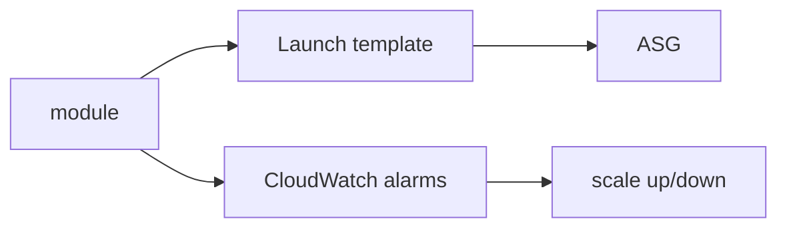

# cloudposse/terraform-aws-ec2-autoscale-group

> Terraform module that creates an AWS Auto Scaling group, its launch template, policies and CPU alarms.

## The problem
A useful ASG requires a launch template, scale-up and scale-down policies, CloudWatch alarms and secure metadata.

## What it actually does
Creates the ASG, the launch template, two policies (`scale_up`, `scale_down`) and CloudWatch alarms on CPU, plus custom alarms. Only `SimpleScaling` is supported; for other types, create the policy yourself. Spot, warm pool, instance refresh and IMDSv2 required by default.

## How it is wired


## Trying it
```bash
module "autoscale_group" { source = "cloudposse/ec2-autoscale-group/aws" }
```
Required inputs: `instance_type`, `min_size`, `max_size`, `subnet_ids`.

## Cost and gotchas
EC2 instances and alarms are on you. The keys of custom alarms must all be present.

## What it is not
Not Kubernetes scaling nor built-in target tracking.

## Alternatives
terraform-aws-ec2-instance for a single instance (cited in the README).

## For you
Worth watching: handy for farms of training or inference workers on EC2, with few advanced policies.
