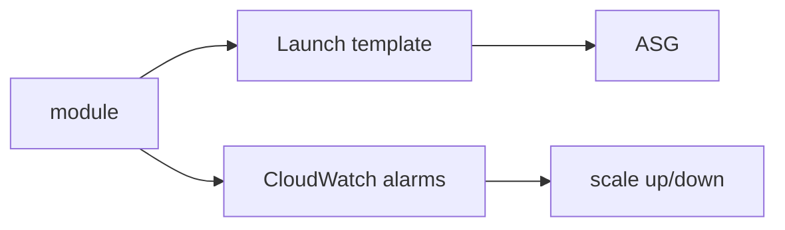

# cloudposse/terraform-aws-ec2-autoscale-group

> Module Terraform qui crée un groupe Auto Scaling AWS, son launch template, ses politiques et alarmes CPU.

## Le problème
Un ASG utile demande launch template, politiques de montée et descente, alarmes CloudWatch et métadonnées sécurisées.

## Ce que ça fait vraiment
Crée l'ASG, le launch template, deux politiques (`scale_up`, `scale_down`) et des alarmes CloudWatch sur le CPU, plus des alarmes personnalisées. Seul `SimpleScaling` est supporté ; pour d'autres types, créer la politique soi-même. Spot, warm pool, instance refresh et IMDSv2 exigé par défaut.

## Comment c'est branché


## Essayer
```bash
module "autoscale_group" { source = "cloudposse/ec2-autoscale-group/aws" }
```
Entrées requises : `instance_type`, `min_size`, `max_size`, `subnet_ids`.

## Coût et pièges
Instances EC2 et alarmes à ta charge. Les clés des alarmes personnalisées doivent toutes être présentes.

## Ce que ce n'est pas
Pas du scaling Kubernetes ni du target tracking intégré.

## Alternatives
terraform-aws-ec2-instance pour une instance seule (cité dans le README).

## Pour toi
À surveiller : pratique pour des fermes de workers d'entraînement ou d'inférence sur EC2, avec peu de politiques avancées.

