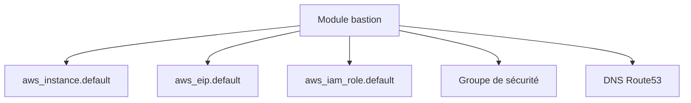

# cloudposse/terraform-aws-ec2-bastion-server

> Terraform module that creates an AWS bastion host with SSM access, for infrastructure teams.

## The problem
Giving access to a private AWS network requires manually configuring the instance, IAM role, security group and DNS.

## What it actually does
The module creates an EC2 instance (Amazon Linux by default), an elastic IP, an IAM profile and role, a security group (SSH open to 0.0.0.0/0 by default) and a Route53 record. The SSM agent is enabled by default and `user_data` is configurable.

## How it is wired
Simplified diagram based on the fiche, no diagram provided.



## Trying it
```sh
atmos test run
atmos test clean
atmos test --help
```
The README gives no example of calling the module; the commands above are those of the tests.

## Cost and gotchas
An AWS account, Terraform or OpenTofu, and the instance bill. The SSH rule open to the whole Internet by default must be restricted.

## What it is not
Not a turnkey access solution: you must supply `vpc_id` and `subnets`. The README heavily promotes Cloud Posse's commercial services.

## Alternatives
No alternative named; the README cites terraform-aws-ec2-instance and terraform-aws-ec2-ami-backup as neighboring modules.

## For you
Worth watching: a clean infrastructure building block if you build AWS with Terraform, but with no direct link to a model or data.
