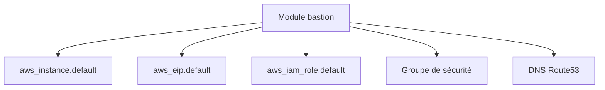

# cloudposse/terraform-aws-ec2-bastion-server

> Module Terraform qui crée un hôte bastion AWS avec accès SSM, pour équipes d'infrastructure.

## Le problème
Donner accès à un réseau privé AWS demande de configurer à la main instance, rôle IAM, groupe de sécurité et DNS.

## Ce que ça fait vraiment
Le module crée une instance EC2 (Amazon Linux par défaut), une IP élastique, un profil et un rôle IAM, un groupe de sécurité (SSH ouvert à 0.0.0.0/0 par défaut) et un enregistrement Route53. L'agent SSM est activé par défaut et `user_data` est paramétrable.

## Comment c'est branché
Schéma simplifié d'après la fiche, sans diagramme fourni.



## Essayer
```sh
atmos test run
atmos test clean
atmos test --help
```
Le README ne donne pas d'exemple d'appel du module ; les commandes ci-dessus sont celles des tests.

## Coût et pièges
Un compte AWS, Terraform ou OpenTofu, et la facture de l'instance. La règle SSH ouverte à tout Internet par défaut est à restreindre.

## Ce que ce n'est pas
Pas une solution d'accès clé en main : il faut fournir `vpc_id` et `subnets`. Le README met beaucoup en avant les services commerciaux de Cloud Posse.

## Alternatives
Aucune alternative nommée ; le README cite terraform-aws-ec2-instance et terraform-aws-ec2-ami-backup comme modules voisins.

## Pour toi
À surveiller : brique d'infrastructure propre si tu montes de l'AWS sous Terraform, mais sans rapport direct avec un modèle ou une donnée.

