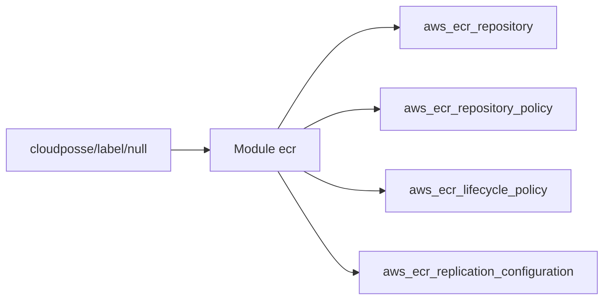

# cloudposse/terraform-aws-ecr

> Terraform module that creates AWS ECR container registries with access and lifecycle policies.

## The problem
Creating ECR repositories by hand, with access policies, scanning and image cleanup, is repetitive and prone to drift.

## What it actually does
Creates one or more ECR repositories sharing the same configuration: repository policy (full access, read-only, push), lifecycle rules, replication and tag mutability filters. Scan on push is enabled by default. It only creates the repository policy, not the principals' IAM policies.

## How it is wired


## Trying it
```bash
atmos test run
atmos test clean
```
Usage: a `module "ecr"` block with `source = "cloudposse/ecr/aws"`, as in the README.

## Cost and gotchas
AWS account and aws provider >= 6.8.0; ECR billing is on you. Principals still need their own IAM policies. Pin the module version.

## What it is not
Not an image-pushing tool, nor a complete IAM module. The README contains a lot of advertising for Cloud Posse's commercial offering.

## Alternatives
No alternative named in the README.

## For you
Watch: handy if you publish model or service images on AWS with Terraform; otherwise irrelevant.
