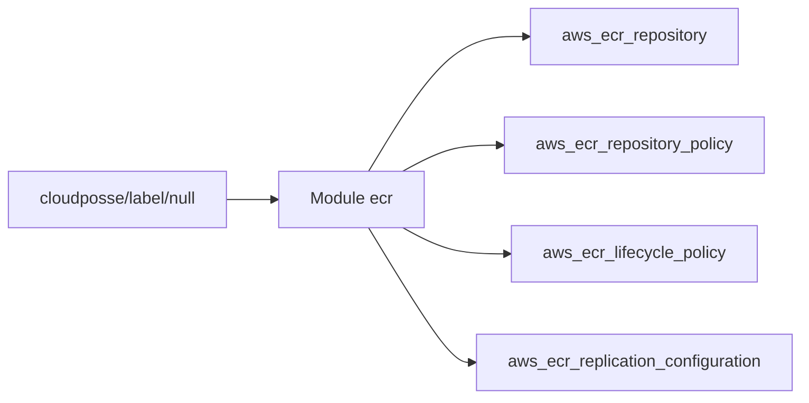

# cloudposse/terraform-aws-ecr

> Module Terraform qui crée des registres de conteneurs AWS ECR avec politiques d'accès et cycle de vie.

## Le problème
Créer des dépôts ECR à la main, avec politiques d'accès, scan et nettoyage des images, est répétitif et source d'écarts.

## Ce que ça fait vraiment
Crée un ou plusieurs dépôts ECR partageant la même configuration : politique de dépôt (accès complet, lecture seule, push), règles de cycle de vie, réplication et filtres de mutabilité des tags. Le scan à l'envoi est activé par défaut. Il ne crée que la politique du dépôt, pas les politiques IAM des principaux.

## Comment c'est branché


## Essayer
```bash
atmos test run
atmos test clean
```
Utilisation : bloc `module "ecr"` avec `source = "cloudposse/ecr/aws"`, comme dans le README.

## Coût et pièges
Compte AWS et fournisseur aws >= 6.8.0 ; facturation ECR à ta charge. Les principaux ont encore besoin de leurs propres politiques IAM. Épingler la version du module.

## Ce que ce n'est pas
Pas un outil d'envoi d'images, ni un module IAM complet. Le README contient beaucoup de publicité pour l'offre commerciale de Cloud Posse.

## Alternatives
Aucune alternative nommée dans le README.

## Pour toi
À surveiller : pratique si tu publies des images de modèles ou de services sur AWS avec Terraform ; sinon sans objet.

