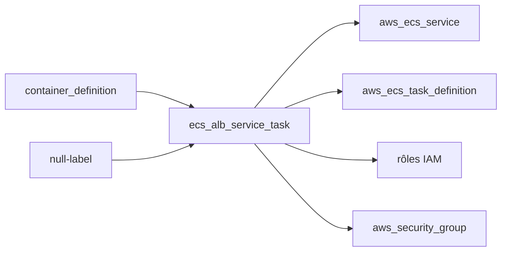

# cloudposse/terraform-aws-ecs-alb-service-task

> Terraform module that creates an ECS service and its ALB target group, for AWS teams.

## The problem
An ECS service requires IAM roles, security groups, task definition and ALB wiring by hand, to be redone for every service.

## What it actually does
Creates `aws_ecs_service`, `aws_ecs_task_definition`, three IAM roles (task, exec, service), a security group and its rules. Supports Fargate or EC2, Service Connect, EFS/FSx volumes, and native ECS blue/green (AWS provider >= 6.4, `ROLLING` and `BLUE_GREEN` strategies only). The blue/green prerequisites (listener rule, IAM role) remain your responsibility.

## How it is wired


## Trying it
```hcl
module "ecs_alb_service_task" {
  source = "cloudposse/ecs-alb-service-task/aws"
  # version = "x.x.x"
  container_definition_json = module.container_definition.json
  ecs_cluster_arn           = aws_ecs_cluster.default.arn
  vpc_id                    = module.vpc.vpc_id
}
```
Tests: `atmos test run`.

## Cost and gotchas
AWS bill (Fargate, ALB, NAT). Terraform >= 1.9, aws provider >= 6.4. Pin the module version, the README insists on it.

## What it is not
Not an ALB: you must provide it separately (terraform-aws-alb). No LINEAR/CANARY support.

## Alternatives
terraform-aws-ecs-web-app (same publisher, complete web application on ECS).

## For you
Worth watching: useful if you deploy inference APIs on ECS/Fargate with Terraform, of no interest outside AWS.
