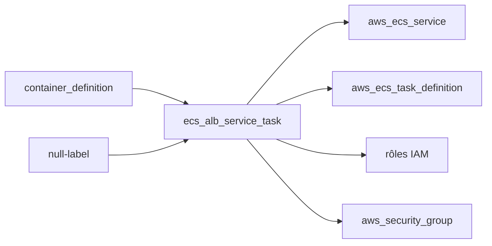

# cloudposse/terraform-aws-ecs-alb-service-task

> Module Terraform créant un service ECS et son groupe cible ALB, pour équipes AWS.

## Le problème
Un service ECS exige à la main rôles IAM, groupes de sécurité, définition de tâche et branchement ALB, à refaire pour chaque service.

## Ce que ça fait vraiment
Crée `aws_ecs_service`, `aws_ecs_task_definition`, trois rôles IAM (task, exec, service), un groupe de sécurité et ses règles. Supporte Fargate ou EC2, Service Connect, volumes EFS/FSx, et le blue/green natif ECS (provider AWS >= 6.4, stratégies `ROLLING` et `BLUE_GREEN` seulement). Les prérequis du blue/green (règle de listener, rôle IAM) restent à ta charge.

## Comment c'est branché


## Essayer
```hcl
module "ecs_alb_service_task" {
  source = "cloudposse/ecs-alb-service-task/aws"
  # version = "x.x.x"
  container_definition_json = module.container_definition.json
  ecs_cluster_arn           = aws_ecs_cluster.default.arn
  vpc_id                    = module.vpc.vpc_id
}
```
Tests : `atmos test run`.

## Coût et pièges
Facture AWS (Fargate, ALB, NAT). Terraform >= 1.9, provider aws >= 6.4. Épingler la version du module, le README insiste.

## Ce que ce n'est pas
Pas un ALB : il faut le fournir à part (terraform-aws-alb). Pas de support LINEAR/CANARY.

## Alternatives
terraform-aws-ecs-web-app (même éditeur, application web complète sur ECS).

## Pour toi
Surveiller : utile si tu déploies des API d'inférence sur ECS/Fargate avec Terraform, sans intérêt hors AWS.

