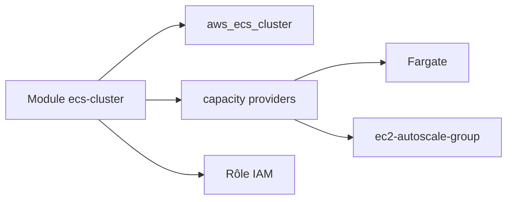

# cloudposse/terraform-aws-ecs-cluster

> Cloud Posse Terraform module that creates an AWS ECS cluster with Fargate and EC2 capacity providers.

## The problem
Setting up an ECS cluster by hand takes many repetitive IAM resources, autoscaling and naming settings.

## What it actually does
The module creates the cluster, its capacity providers (Fargate, Fargate Spot, EC2 autoscaling groups, external groups), an IAM role and its instance profile. It reuses `null-label` for naming and `ec2-autoscale-group` for the EC2 groups. The Container Insights mode is configurable (`enhanced` costs more).

## How it is wired
Simplified diagram based on the fiche, no diagram provided.



## Trying it
```hcl
module "ecs_cluster" {
  source = "cloudposse/ecs-cluster/aws"

  namespace = "eg"
  name      = "example"

  container_insights_mode    = "enhanced"
  capacity_providers_fargate = true
}
```

## Cost and gotchas
You need an AWS account: the resources created are billed by AWS, the module is free. Terraform 1.3 or later and aws provider 6.0 or later. The README advises pinning the module version.

## What it is not
It is not an application deployment: it only creates the cluster. ECS services are handled by other modules.

## Alternatives
- terraform-aws-ecs-web-app: to deploy a complete web application on ECS.
- terraform-aws-ecs-alb-service-task: to expose an ECS service behind an ALB.
- terraform-aws-ecs-atlantis: to deploy Atlantis as an ECS task.

## For you
Watch: useful if your models or pipelines run on ECS, of no interest if you do not manage the AWS infrastructure yourself.
