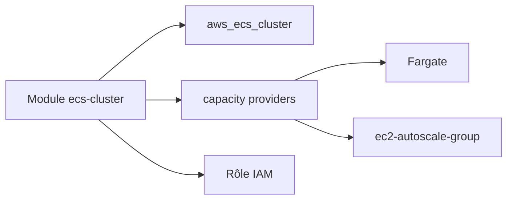

# cloudposse/terraform-aws-ecs-cluster

> Module Terraform de Cloud Posse qui crée un cluster AWS ECS avec capacity providers Fargate et EC2.

## Le problème
Monter un cluster ECS à la main demande beaucoup de ressources IAM, d'autoscaling et de réglages de nommage répétitifs.

## Ce que ça fait vraiment
Le module crée le cluster, ses capacity providers (Fargate, Fargate Spot, groupes EC2 autoscaling, groupes externes), un rôle IAM et son profil d'instance. Il réutilise `null-label` pour le nommage et `ec2-autoscale-group` pour les groupes EC2. Le mode Container Insights se règle (`enhanced` coûte plus).

## Comment c'est branché
Schéma simplifié d'après la fiche, sans diagramme fourni.



## Essayer
```hcl
module "ecs_cluster" {
  source = "cloudposse/ecs-cluster/aws"

  namespace = "eg"
  name      = "example"

  container_insights_mode    = "enhanced"
  capacity_providers_fargate = true
}
```

## Coût et pièges
Il faut un compte AWS : les ressources créées sont facturées par AWS, le module est gratuit. Terraform 1.3 ou plus et provider aws 6.0 ou plus. Le README conseille d'épingler la version du module.

## Ce que ce n'est pas
Ce n'est pas un déploiement d'application : il ne crée que le cluster. Les services ECS relèvent d'autres modules.

## Alternatives
- terraform-aws-ecs-web-app : pour déployer une application web complète sur ECS.
- terraform-aws-ecs-alb-service-task : pour exposer un service ECS derrière un ALB.
- terraform-aws-ecs-atlantis : pour déployer Atlantis comme tâche ECS.

## Pour toi
À surveiller : utile si tes modèles ou pipelines tournent sur ECS, sans intérêt si tu ne gères pas toi-même l'infrastructure AWS.

