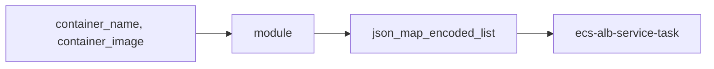

# cloudposse/terraform-aws-ecs-container-definition

> Terraform module that generates the container definition JSON for `aws_ecs_task_definition`.

## The problem
Writing ECS container JSON by hand is verbose and prone to typing errors.

## What it actually does
A module with no resource or provider: it only produces outputs (`json_map_encoded`, `json_map_encoded_list`, `json_map_object`, sensitive versions). It exposes the ECS fields (ports, secrets, logs, health check, ulimits...). Do not pass it `context = module.this.context`.

## How it is wired


## Trying it
```bash
terraform init
```
`module "container_definition"` block with `source = "cloudposse/ecs-container-definition/aws"`.

## Cost and gotchas
Free; the cost comes from ECS/AWS. `environment` has a different meaning here than in null-label. Last push October 2025.

## What it is not
Creates no AWS resource by itself.

## Alternatives
No alternative named in the README.

## For you
Worth watching: handy if you deploy on ECS with Terraform, useless otherwise.
