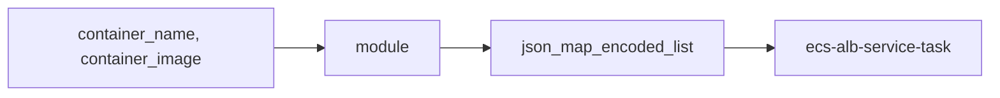

# cloudposse/terraform-aws-ecs-container-definition

> Module Terraform qui génère le JSON de définition de conteneur pour `aws_ecs_task_definition`.

## Le problème
Écrire à la main le JSON des containers ECS est verbeux et sujet aux erreurs de typage.

## Ce que ça fait vraiment
Module sans ressource ni provider : il produit seulement des sorties (`json_map_encoded`, `json_map_encoded_list`, `json_map_object`, versions sensibles). Il expose les champs ECS (ports, secrets, logs, health check, ulimits...). Ne pas lui passer `context = module.this.context`.

## Comment c'est branché


## Essayer
```bash
terraform init
```
Bloc `module "container_definition"` avec `source = "cloudposse/ecs-container-definition/aws"`.

## Coût et pièges
Gratuit ; le coût vient d'ECS/AWS. `environment` a ici un sens différent de null-label. Dernier push octobre 2025.

## Ce que ce n'est pas
Ne crée aucune ressource AWS par lui-même.

## Alternatives
Aucune alternative nommée dans le README.

## Pour toi
À surveiller : pratique si tu déploies sur ECS avec Terraform, inutile sinon.

