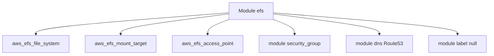

# cloudposse/terraform-aws-efs

> Cloud Posse Terraform module that creates an AWS EFS network file system, for infra teams.

## The problem
Setting up an EFS by hand (file system, mount targets, security group, backup policy, DNS) is slow and hard to reproduce.

## What it actually does
Creates `aws_efs_file_system`, the mount targets, the access points, a backup policy and a file system policy. It also creates a security group (`security-group` module) and an optional Route53 CNAME (`route53-cluster-hostname` module). Encryption is enabled by default; IA/Glacier transitions and throughput are configurable.

## How it is wired


## Trying it
```bash
atmos test run
atmos test clean
atmos test --help
```
Usage: a `module "efs" { source = "cloudposse/efs/aws" ... }` block with `vpc_id`, `subnets`, `region`.

## Cost and gotchas
AWS account required; EFS is billed. Terraform >= 1.1.0, aws provider >= 6.12.0. Version 0.32.0 contains breaking changes (security group migration).

## What it is not
Not a data tool: pure AWS infrastructure. The README is mostly Cloud Posse marketing and a generated reference.

## Alternatives
`terraform-aws-efs-backup` and `terraform-aws-efs-cloudwatch-sns-alarms` (listed as related projects) complement the module.

## For you
Keep an eye on it: useful if you set up shared AWS storage (notebooks, training) with Terraform, otherwise irrelevant.
