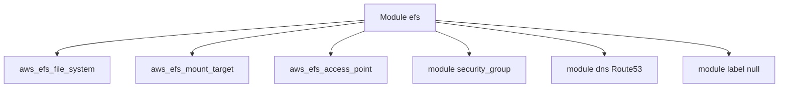

# cloudposse/terraform-aws-efs

> Module Terraform de Cloud Posse pour créer un système de fichiers réseau AWS EFS, pour équipes infra.

## Le problème
Monter un EFS à la main (système de fichiers, cibles de montage, groupe de sécurité, politique de sauvegarde, DNS) est long et peu reproductible.

## Ce que ça fait vraiment
Crée `aws_efs_file_system`, les mount targets, les access points, une politique de sauvegarde et une politique de système de fichiers. Crée aussi un groupe de sécurité (module `security-group`) et un CNAME Route53 optionnel (module `route53-cluster-hostname`). Chiffrement activé par défaut ; transitions IA/Glacier et débit configurables.

## Comment c'est branché


## Essayer
```bash
atmos test run
atmos test clean
atmos test --help
```
Usage : bloc `module "efs" { source = "cloudposse/efs/aws" ... }` avec `vpc_id`, `subnets`, `region`.

## Coût et pièges
Compte AWS ; l'EFS est facturé. Terraform >= 1.1.0, provider aws >= 6.12.0. La version 0.32.0 contient des changements cassants (migration du groupe de sécurité).

## Ce que ce n'est pas
Pas un outil de données : de l'infra AWS pure. Le README est surtout du marketing Cloud Posse et une référence générée.

## Alternatives
`terraform-aws-efs-backup` et `terraform-aws-efs-cloudwatch-sns-alarms` (cités en projets liés) complètent le module.

## Pour toi
Surveiller : utile si tu montes du stockage partagé AWS (notebooks, entraînement) avec Terraform, sinon sans objet.

