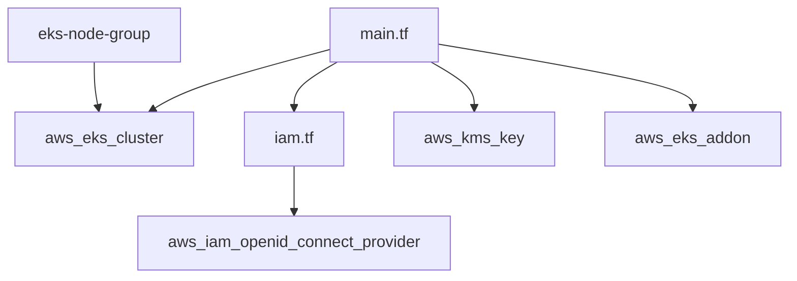

# cloudposse/terraform-aws-eks-cluster

> Terraform module that creates an EKS cluster on AWS, for teams that deploy with the Cloud Posse architecture.

## The problem
Setting up an EKS control plane by hand (IAM, OIDC, access, encryption, logs) is long and prone to configuration errors.

## What it actually does
- Creates `aws_eks_cluster`, its IAM role, the OIDC provider, a KMS key and a CloudWatch log group.
- Manages cluster access through EKS access entries, via the AWS API, plus the vpc-cni, kube-proxy and coredns add-ons.
- Supports EKS Auto Mode and advanced control plane configuration.
- Nodes come from separate modules (`eks-node-group`, `eks-workers`).

## How it is wired

## Trying it
The README provides HCL blocks (`module "eks_cluster"`, `source = "cloudposse/eks-cluster/aws"`); it contains no shell command. See `examples/complete`.

## Cost and gotchas
An AWS account is required: the cluster, nodes and NAT are billed. Version 4.0.0 breaks compatibility; 2.0.0 may recreate an existing cluster. Pin the module version.

## What it is not
Not a complete cluster: without node, VPC and subnet modules, nothing runs. Removing an advanced option does not reset it to default on the AWS side.

## Alternatives
No alternative named in the README, apart from Cloud Posse's companion modules.

## For you
Worth watching: only if your MLOps infrastructure goes through Terraform on EKS; otherwise the gap with a simple managed cluster is not worth it.
