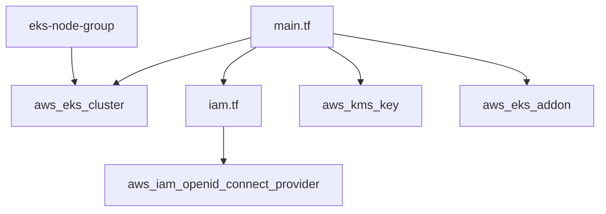

# cloudposse/terraform-aws-eks-cluster

> Module Terraform qui crée un cluster EKS sur AWS, pour les équipes qui déploient avec l'architecture Cloud Posse.

## Le problème
Monter un plan de contrôle EKS à la main (IAM, OIDC, accès, chiffrement, journaux) est long et source d'erreurs de configuration.

## Ce que ça fait vraiment
- Crée `aws_eks_cluster`, son rôle IAM, le fournisseur OIDC, une clé KMS et un groupe de logs CloudWatch.
- Gère l'accès au cluster par les entrées d'accès EKS, via l'API AWS, plus les add-ons vpc-cni, kube-proxy et coredns.
- Prend en charge EKS Auto Mode et la configuration avancée du plan de contrôle.
- Les nœuds viennent de modules séparés (`eks-node-group`, `eks-workers`).

## Comment c'est branché

## Essayer
Le README fournit des blocs HCL (`module "eks_cluster"`, `source = "cloudposse/eks-cluster/aws"`) ; il ne contient pas de commande shell. Voir `examples/complete`.

## Coût et pièges
Un compte AWS est requis : le cluster, les nœuds et la NAT sont facturés. La version 4.0.0 casse la compatibilité ; la 2.0.0 peut recréer un cluster existant. Épingler la version du module.

## Ce que ce n'est pas
Pas un cluster complet : sans modules de nœuds, VPC et sous-réseaux, rien ne tourne. Retirer une option avancée ne la remet pas par défaut côté AWS.

## Alternatives
Aucune alternative nommée dans le README, hormis les modules compagnons de Cloud Posse.

## Pour toi
À surveiller : seulement si ton infrastructure MLOps passe par Terraform sur EKS ; sinon l'écart avec un cluster managé simple n'en vaut pas la peine.

