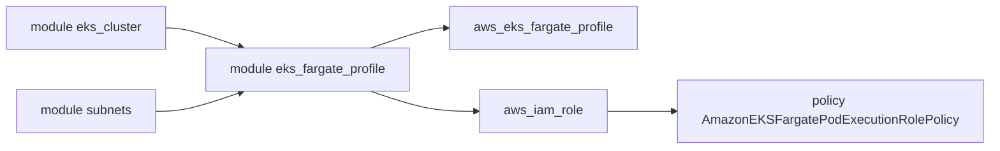

# cloudposse/terraform-aws-eks-fargate-profile

> Terraform module that creates a Fargate profile and its pod execution role for EKS.

## The problem
Running EKS pods on Fargate requires a profile, an IAM role and selectors that are correctly linked together.

## What it actually does
Creates `aws_eks_fargate_profile`, an IAM role with the Fargate execution policy, and consistent labels. A single execution role is enough per AWS account: with `fargate_profile_enabled = false`, the module creates the role without a profile. Selectors rely on Kubernetes namespace and labels.

## How it is wired
Simplified diagram based on the sheet, no diagram provided.



## Trying it
```bash
atmos test run
atmos test clean
```
The full usage is a long HCL example (VPC, subnets, EKS cluster, node group, Fargate profile) given in the README.

## Cost and gotchas
AWS account required; EKS and Fargate are billed. The README asks you to pin the module version. Subnets must carry the `kubernetes.io/cluster/CLUSTER_NAME` tag.

## What it is not
Not an EKS cluster module: a cluster must already exist (see terraform-aws-eks-cluster, a neighboring module).

## Alternatives
terraform-aws-eks-node-group and terraform-aws-eks-workers, cited in the README, cover EC2 nodes rather than Fargate.

## For you
Worth watching: useful for light inference pods without nodes to manage on EKS, not for GPU.
