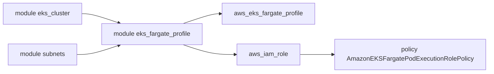

# cloudposse/terraform-aws-eks-fargate-profile

> Module Terraform qui crée un profil Fargate et son rôle d'exécution de pods pour EKS.

## Le problème
Faire tourner des pods EKS sur Fargate exige un profil, un rôle IAM et des sélecteurs correctement reliés.

## Ce que ça fait vraiment
Crée `aws_eks_fargate_profile`, un rôle IAM avec la politique d'exécution Fargate et les étiquettes cohérentes. Un seul rôle d'exécution suffit par compte AWS : avec `fargate_profile_enabled = false`, le module crée le rôle sans profil. Les sélecteurs reposent sur namespace et labels Kubernetes.

## Comment c'est branché
Schéma simplifié d'après la fiche, sans diagramme fourni.



## Essayer
```bash
atmos test run
atmos test clean
```
L'usage complet est un long exemple HCL (VPC, sous-réseaux, cluster EKS, groupe de nœuds, profil Fargate) donné dans le README.

## Coût et pièges
Compte AWS requis ; EKS et Fargate sont facturés. Le README demande d'épingler la version du module. Les sous-réseaux doivent porter l'étiquette `kubernetes.io/cluster/CLUSTER_NAME`.

## Ce que ce n'est pas
Ce n'est pas un module de cluster EKS : il faut déjà un cluster (voir terraform-aws-eks-cluster, module voisin).

## Alternatives
terraform-aws-eks-node-group et terraform-aws-eks-workers, cités dans le README, couvrent des nœuds EC2 plutôt que Fargate.

## Pour toi
À surveiller : utile pour des pods d'inférence légers sans nœuds à gérer sur EKS, pas pour du GPU.

