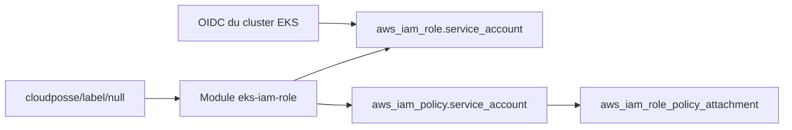

# cloudposse/terraform-aws-eks-iam-role

> Terraform module that creates an AWS IAM role for a Kubernetes service account on EKS.

## The problem
Giving an EKS pod precise AWS permissions requires binding an IAM role to a service account through the cluster's OIDC issuer.

## What it actually does
The module creates the role, an optional IAM policy from a JSON document, and attachments of managed policies. It takes the cluster's OIDC URL, and the service account's name and namespace. Names follow the `terraform-null-label` convention.

## How it is wired


## Trying it
```bash
atmos test run
atmos test clean
atmos test --help
```

## Cost and gotchas
An AWS account and an EKS cluster are required, plus Terraform 1.2 or later. The tests require Atmos and Go 1.24. The README contains advertising for Cloud Posse's commercial offering.

## What it is not
Not a module that creates the EKS cluster. It is not version-locked: the README advises pinning the version.

## Alternatives
terraform-null-label, the related module cited by the README, for names and labels.

## For you
Worth watching: handy if you deploy AI workloads on EKS with Terraform, otherwise of no interest.
