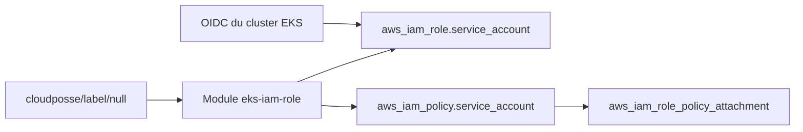

# cloudposse/terraform-aws-eks-iam-role

> Module Terraform qui crée un rôle IAM AWS pour un compte de service Kubernetes sur EKS.

## Le problème
Donner à un pod EKS des droits AWS précis demande de lier un rôle IAM à un compte de service via l'émetteur OIDC du cluster.

## Ce que ça fait vraiment
Le module crée le rôle, une politique IAM facultative à partir d'un document JSON, et les rattachements de politiques gérées. Il prend l'URL OIDC du cluster, le nom et le namespace du compte de service. Les noms suivent la convention de `terraform-null-label`.

## Comment c'est branché


## Essayer
```bash
atmos test run
atmos test clean
atmos test --help
```

## Coût et pièges
Compte AWS et cluster EKS requis, Terraform 1.2 ou plus. Les tests demandent Atmos et Go 1.24. Le README contient de la publicité pour l'offre commerciale de Cloud Posse.

## Ce que ce n'est pas
Pas un module qui crée le cluster EKS. Il n'est pas verrouillé sur une version : le README conseille d'épingler la version.

## Alternatives
terraform-null-label, module associé cité par le README, pour les noms et étiquettes.

## Pour toi
À surveiller : pratique si tu déploies des charges de travail IA sur EKS avec Terraform, sinon sans intérêt.

