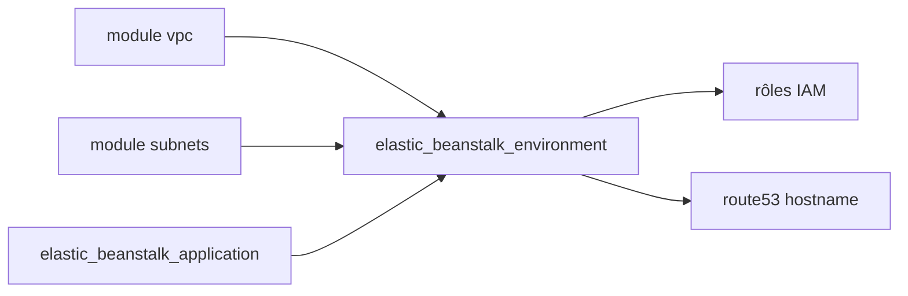

# cloudposse/terraform-aws-elastic-beanstalk-environment

> Terraform module that creates an AWS Elastic Beanstalk environment, for infrastructure teams on AWS.

## The problem
Configuring a Beanstalk environment by hand (load balancer, autoscaling, IAM roles, DNS) is slow and hard to reproduce.

## What it actually does
Creates the Beanstalk environment with its IAM roles, security groups, policies, an HTTP-to-HTTPS redirect rule and optional logs. Dozens of variables control autoscaling, deployment, health checks and spot. The neighboring Cloud Posse modules (VPC, subnets, application) are required for the example.

## How it is wired
Simplified diagram based on the sheet, no diagram provided.


## Trying it
```hcl
module "elastic_beanstalk_environment" {
  source = "../../"
  region = var.region
  elastic_beanstalk_application_name = module.elastic_beanstalk_application.elastic_beanstalk_application_name
  context = module.this.context
}
```
Full example: examples/complete.

## Cost and gotchas
AWS account: instances, load balancer and storage are billed. Terraform >= 1.3.0 and aws provider >= 4.0. The module should be pinned to a specific version.

## What it is not
It is not an application deployment tool. Cloud Posse is looking for a maintainer for this repository: succession is uncertain, even though the last push is recent.

## Alternatives
No alternative named in the README.

## For you
Ignore unless you already host on Beanstalk: for a data or MLOps profile, Beanstalk is rarely the deployment target.
