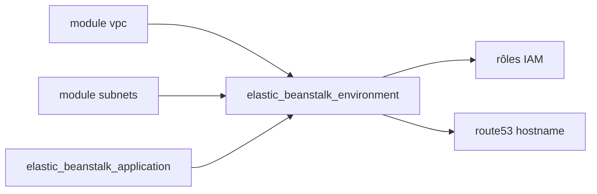

# cloudposse/terraform-aws-elastic-beanstalk-environment

> Module Terraform qui crée un environnement AWS Elastic Beanstalk, pour équipes infrastructure sur AWS.

## Le problème
Configurer à la main un environnement Beanstalk (load balancer, autoscaling, rôles IAM, DNS) est long et peu reproductible.

## Ce que ça fait vraiment
Crée l'environnement Beanstalk avec ses rôles IAM, groupes de sécurité, politiques, règle de redirection HTTP vers HTTPS et logs optionnels. Des dizaines de variables contrôlent autoscaling, déploiement, health checks et spot. Les modules Cloud Posse voisins (VPC, subnets, application) sont requis pour l'exemple.

## Comment c'est branché
Schéma simplifié d'après la fiche, sans diagramme fourni.


## Essayer
```hcl
module "elastic_beanstalk_environment" {
  source = "../../"
  region = var.region
  elastic_beanstalk_application_name = module.elastic_beanstalk_application.elastic_beanstalk_application_name
  context = module.this.context
}
```
Exemple complet : examples/complete.

## Coût et pièges
Compte AWS : les instances, le load balancer et le stockage sont facturés. Terraform >= 1.3.0 et provider aws >= 4.0. Le module est à épingler à une version précise.

## Ce que ce n'est pas
Ce n'est pas un outil de déploiement d'application. Cloud Posse cherche un mainteneur pour ce dépôt : la relève est incertaine, même si le dernier push est récent.

## Alternatives
Aucune alternative nommée dans le README.

## Pour toi
À ignorer sauf si tu héberges déjà sur Beanstalk : pour un profil data ou MLOps, Beanstalk est rarement la cible de déploiement.

