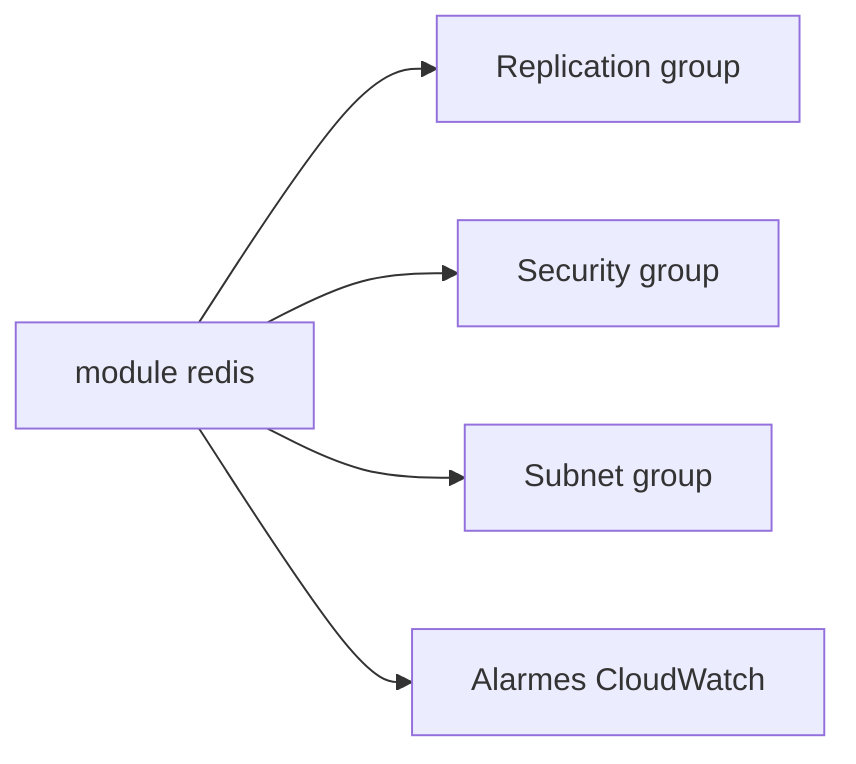

# cloudposse/terraform-aws-elasticache-redis

> Terraform module that provisions an ElastiCache Redis cluster or a serverless instance.

## The problem
A secure managed Redis requires a replication group, subnets, a security group, parameters and alarms.

## What it actually does
Creates the replication group or the serverless cache, the parameter group, the subnet group, a security group, CPU and memory alarms, and an optional DNS record. Encryption in transit is on by default: direct `redis-cli` is not possible without stunnel.

## How it is wired


## Trying it
```bash
module "redis" { source = "cloudposse/elasticache-redis/aws" }
```
Required inputs: `vpc_id` (other variables depend on the example).

## Cost and gotchas
The ElastiCache bill is on you. Breaking change in 0.41.0; do not attach other resources to the security group it creates.

## What it is not
Not a Redis client nor an application caching tool.

## Alternatives
terraform-aws-security-group for a stable security group (cited in the README).

## For you
Worth watching: useful for a lightweight cache or feature store on AWS, but the last push in June 2026 needs checking.
