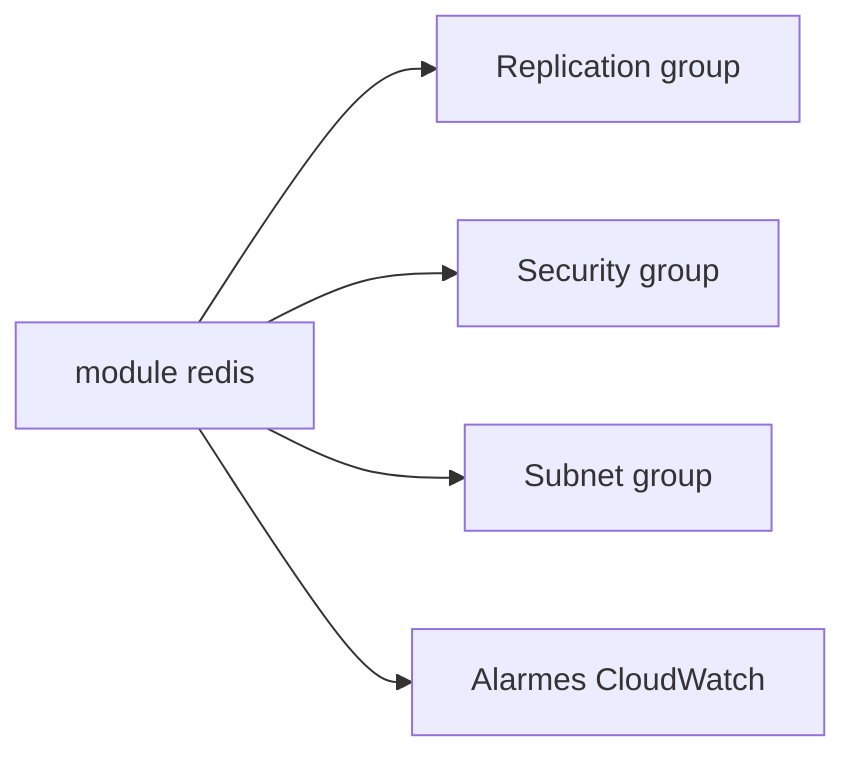

# cloudposse/terraform-aws-elasticache-redis

> Module Terraform qui provisionne un cluster ElastiCache Redis ou une instance serverless.

## Le problème
Un Redis managé sécurisé exige groupe de réplication, sous-réseaux, groupe de sécurité, paramètres et alarmes.

## Ce que ça fait vraiment
Crée le groupe de réplication ou le cache serverless, le groupe de paramètres, le groupe de sous-réseaux, un groupe de sécurité, des alarmes CPU et mémoire, et un enregistrement DNS optionnel. Chiffrement en transit actif par défaut : `redis-cli` direct impossible sans stunnel.

## Comment c'est branché


## Essayer
```bash
module "redis" { source = "cloudposse/elasticache-redis/aws" }
```
Entrées requises : `vpc_id` (autres variables selon l'exemple).

## Coût et pièges
Facture ElastiCache à ta charge. Changement disruptif à la 0.41.0 ; ne pas lier d'autres ressources au groupe de sécurité créé.

## Ce que ce n'est pas
Pas un client Redis ni un outil de cache applicatif.

## Alternatives
terraform-aws-security-group pour un groupe de sécurité stable (cité dans le README).

## Pour toi
À surveiller : utile pour un cache ou feature store léger sur AWS, mais dernier push juin 2026 à vérifier.

