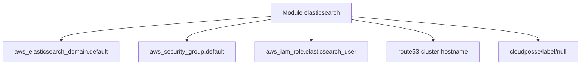

# cloudposse/terraform-aws-elasticsearch

> Terraform module that creates an Elasticsearch or OpenSearch domain on AWS, with Kibana, for infrastructure teams.

## The problem
Setting up a managed Elasticsearch domain on AWS by hand requires networking, security groups, IAM and DNS, which are hard to reproduce.

## What it actually does
Creates the domain (`aws_elasticsearch_domain` or `aws_opensearch_domain` resource), its access policy, a security group, a user IAM role and DNS records for the domain and Kibana if a zone is provided. Supports Cognito, CloudWatch logs, UltraWarm and encryption.

## How it is wired


## Trying it
```bash
# Exemple fourni dans le README : examples/complete
# Tests : dossier test (bats et Terratest)
```
The README mainly gives an HCL `module "elasticsearch"` block with `source = "cloudposse/elasticsearch/aws"`.

## Cost and gotchas
The module is free, the AWS domain is billed. It requires Terraform 1.3 or later and the AWS provider 5.15 or later. Pin the module version.

## What it is not
Not a search tool: it only provisions the infrastructure. The README talks about Elasticsearch, partly superseded by OpenSearch; the choice is made through `aws_service_type`.

## Alternatives
None named in the README.

## For you
Useful if your search or log engine runs on AWS and you manage infrastructure with Terraform; otherwise skip it.
