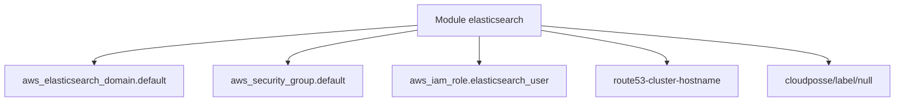

# cloudposse/terraform-aws-elasticsearch

> Module Terraform qui crée un domaine Elasticsearch ou OpenSearch sur AWS, avec Kibana, pour équipes infra.

## Le problème
Monter un domaine Elasticsearch managé sur AWS à la main demande réseau, groupes de sécurité, IAM et DNS, difficiles à reproduire.

## Ce que ça fait vraiment
Crée le domaine (ressource `aws_elasticsearch_domain` ou `aws_opensearch_domain`), sa politique d'accès, un groupe de sécurité, un rôle IAM utilisateur et des enregistrements DNS pour le domaine et Kibana si une zone est fournie. Prend en charge Cognito, logs CloudWatch, UltraWarm et chiffrement.

## Comment c'est branché


## Essayer
```bash
# Exemple fourni dans le README : examples/complete
# Tests : dossier test (bats et Terratest)
```
Le README donne surtout un bloc `module "elasticsearch"` HCL avec `source = "cloudposse/elasticsearch/aws"`.

## Coût et pièges
Le module est gratuit, le domaine AWS est facturé. Il faut Terraform 1.3 ou plus et le fournisseur AWS 5.15 ou plus. Épingler la version du module.

## Ce que ce n'est pas
Pas un outil de recherche : il ne fait qu'approvisionner l'infrastructure. Le README parle d'Elasticsearch, en partie dépassé par OpenSearch ; le choix passe par `aws_service_type`.

## Alternatives
Aucune nommée dans le README.

## Pour toi
Utile si ton moteur de recherche ou de logs tourne sur AWS et que tu gères l'infra avec Terraform ; sinon passe.

