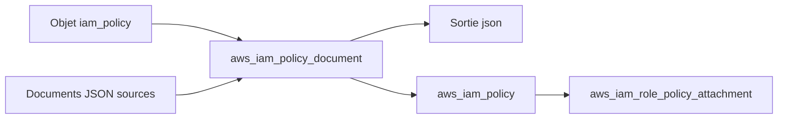

# cloudposse/terraform-aws-iam-policy

> Terraform module that generates an AWS IAM policy document from Terraform objects or YAML.

## The problem
Writing an IAM policy as JSON in Terraform is cumbersome when it comes from a `tfvars` file or an Atmos stack.

## What it actually does
The module wraps the `aws_iam_policy_document` data source. It accepts the policy as a list of Terraform objects, translates it into JSON, merges it with other documents, and can create the IAM policy or attach it to roles. AWS variables use the `&{...}` notation.

## How it is wired
Simplified diagram based on the sheet, no diagram provided.



## Trying it
```hcl
module "iam_policy" {
  source = "cloudposse/iam-policy/aws"

  iam_policy = [{
    version   = "2012-10-17"
    policy_id = "example"
    statements = [{
      sid       = "ListMyBucket"
      effect    = "Allow"
      actions   = ["s3:ListBucket"]
      resources = ["arn:aws:s3:::test"]
    }]
  }]
}
```

## Cost and gotchas
You need an AWS account, Terraform 1.3 or later and the aws and http providers. The module is free. Pinning the version is recommended.

## What it is not
Not useful if you already have the JSON or if `aws_iam_policy_document` is enough for you: the README says so itself.

## Alternatives
- terraform-null-label: to enforce a strict naming convention (related project, not a substitute).

## For you
Ignore: a very narrow Terraform AWS utility, unrelated to data or AI, except for Atmos stacks.
