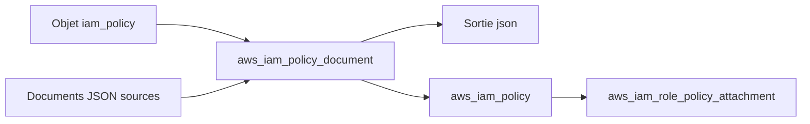

# cloudposse/terraform-aws-iam-policy

> Module Terraform qui génère un document de politique IAM AWS depuis des objets Terraform ou du YAML.

## Le problème
Écrire une politique IAM en JSON dans Terraform est lourd quand elle vient d'un fichier `tfvars` ou d'un stack Atmos.

## Ce que ça fait vraiment
Le module enveloppe la source de données `aws_iam_policy_document`. Il accepte la politique comme liste d'objets Terraform, la traduit en JSON, la fusionne avec d'autres documents, et peut créer la politique IAM ou l'attacher à des rôles. Les variables AWS utilisent la notation `&{...}`.

## Comment c'est branché
Schéma simplifié d'après la fiche, sans diagramme fourni.



## Essayer
```hcl
module "iam_policy" {
  source = "cloudposse/iam-policy/aws"

  iam_policy = [{
    version   = "2012-10-17"
    policy_id = "example"
    statements = [{
      sid       = "ListMyBucket"
      effect    = "Allow"
      actions   = ["s3:ListBucket"]
      resources = ["arn:aws:s3:::test"]
    }]
  }]
}
```

## Coût et pièges
Il faut un compte AWS, Terraform 1.3 ou plus et les providers aws et http. Le module est gratuit. Épingler la version est recommandé.

## Ce que ce n'est pas
Ce n'est pas utile si tu as déjà le JSON ou si `aws_iam_policy_document` te suffit : le README le dit lui-même.

## Alternatives
- terraform-null-label : pour imposer une convention de nommage stricte (projet associé, non substitut).

## Pour toi
À ignorer : utilitaire Terraform AWS très ciblé, sans rapport avec la data ou l'IA, sauf pour des stacks Atmos.

