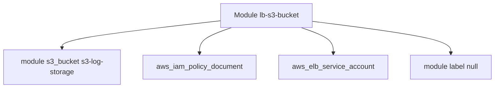

# cloudposse/terraform-aws-lb-s3-bucket

> Terraform module creating an S3 bucket whose IAM policy lets AWS load balancers deposit their logs.

## The problem
AWS load balancer access logs require a bucket with a precise policy, tedious to write by hand.

## What it actually does
Calls the `s3-log-storage` module and adds an IAM policy document based on `aws_elb_service_account` and `aws_partition`. SSL enforced by default (`allow_ssl_requests_only`), versioning enabled, `log-delivery-write` ACL. Lifecycle rules via `lifecycle_configuration_rules` (the old variables are deprecated).

## How it is wired


## Trying it
```bash
# Pas de commande dans le README : utiliser le bloc HCL
# module "s3_bucket" { source = "cloudposse/lb-s3-bucket/aws"
#   namespace = "eg"  stage = "test"  name = "bucket" }
```

## Cost and gotchas
AWS account, S3 storage billed. Terraform >= 1.3.0, aws >= 4.0. `force_destroy` makes objects unrecoverable.

## What it is not
Not a log collection or analysis tool: it only creates the bucket. The README is largely Cloud Posse marketing.

## Alternatives
`terraform-aws-alb` (cited as a related project) creates the ALB itself.

## For you
Ignore: narrow AWS plumbing, with no direct relation to data / AI work.
