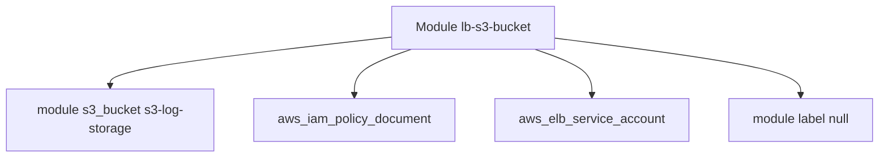

# cloudposse/terraform-aws-lb-s3-bucket

> Module Terraform créant un bucket S3 dont la politique IAM laisse les load balancers AWS déposer leurs logs.

## Le problème
Les logs d'accès des load balancers AWS exigent un bucket avec une politique précise, fastidieuse à écrire à la main.

## Ce que ça fait vraiment
Appelle le module `s3-log-storage` et ajoute un document de politique IAM basé sur `aws_elb_service_account` et `aws_partition`. SSL imposé par défaut (`allow_ssl_requests_only`), versionnement actif, ACL `log-delivery-write`. Règles de cycle de vie via `lifecycle_configuration_rules` (les anciennes variables sont dépréciées).

## Comment c'est branché


## Essayer
```bash
# Pas de commande dans le README : utiliser le bloc HCL
# module "s3_bucket" { source = "cloudposse/lb-s3-bucket/aws"
#   namespace = "eg"  stage = "test"  name = "bucket" }
```

## Coût et pièges
Compte AWS, stockage S3 facturé. Terraform >= 1.3.0, aws >= 4.0. `force_destroy` rend les objets irrécupérables.

## Ce que ce n'est pas
Pas un outil de collecte ni d'analyse de logs : il ne fait que créer le bucket. Le README est en grande partie du marketing Cloud Posse.

## Alternatives
`terraform-aws-alb` (cité en projet lié) crée l'ALB lui-même.

## Pour toi
Ignorer : plomberie AWS étroite, sans rapport direct avec un travail data / IA.

