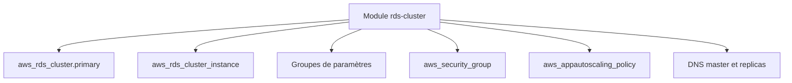

# cloudposse/terraform-aws-rds-cluster

> Terraform module to create an AWS Aurora MySQL or Postgres cluster, including Serverless, for infrastructure teams.

## The problem
An Aurora cluster involves instances, parameter groups, security, DNS, monitoring and scaling to declare separately.

## What it actually does
The module creates a primary cluster and an optional secondary one, instances, parameter groups, a security group, DNS records for writer and readers, reader autoscaling and an enhanced monitoring role. It supports Aurora Serverless, global clusters and reserved instances.

## How it is wired
Simplified diagram based on the sheet, no diagram provided.



## Trying it
```hcl
module "rds_cluster_aurora_postgres" {
  source = "cloudposse/rds-cluster/aws"
  name   = "postgres"
  engine = "aurora-postgresql"
  cluster_family = "aurora-postgresql9.6"
  cluster_size   = 2
}
```
The README gives the complete example (VPC, subnets, admin user).

## Cost and gotchas
AWS account and the bill for Aurora instances. The examples contain plaintext passwords; the README recommends pinning the module version.

## What it is not
Not a module for a simple RDS instance (see terraform-aws-rds). The README examples cite old Aurora versions.

## Alternatives
terraform-aws-rds: for a simple RDS instance, according to the README of this neighboring module.

## For you
Worth watching: useful for an Aurora data warehouse under Terraform, but unrelated to the data processing itself.
