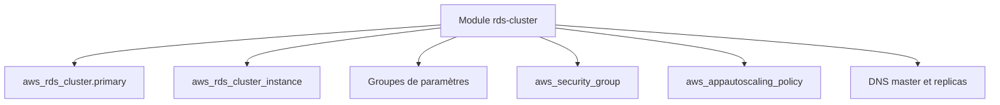

# cloudposse/terraform-aws-rds-cluster

> Module Terraform pour créer un cluster AWS Aurora MySQL ou Postgres, y compris Serverless, pour équipes d'infrastructure.

## Le problème
Un cluster Aurora implique instances, groupes de paramètres, sécurité, DNS, supervision et mise à l'échelle à déclarer séparément.

## Ce que ça fait vraiment
Le module crée un cluster principal et un secondaire optionnel, des instances, des groupes de paramètres, un groupe de sécurité, des enregistrements DNS pour écrivain et lecteurs, l'autoscaling des lecteurs et un rôle de supervision avancée. Il supporte Aurora Serverless, les clusters globaux et les instances réservées.

## Comment c'est branché
Schéma simplifié d'après la fiche, sans diagramme fourni.



## Essayer
```hcl
module "rds_cluster_aurora_postgres" {
  source = "cloudposse/rds-cluster/aws"
  name   = "postgres"
  engine = "aurora-postgresql"
  cluster_family = "aurora-postgresql9.6"
  cluster_size   = 2
}
```
Le README donne l'exemple complet (VPC, sous-réseaux, utilisateur admin).

## Coût et pièges
Compte AWS et facture des instances Aurora. Les exemples contiennent des mots de passe en clair ; le README recommande d'épingler la version du module.

## Ce que ce n'est pas
Pas un module pour une instance RDS simple (voir terraform-aws-rds). Les exemples du README citent des versions anciennes d'Aurora.

## Alternatives
terraform-aws-rds : pour une instance RDS simple, d'après le README de ce module voisin.

## Pour toi
À surveiller : utile pour un entrepôt de données Aurora sous Terraform, mais sans lien avec le traitement des données lui-même.

