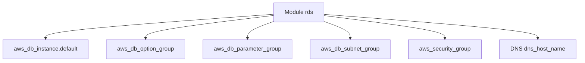

# cloudposse/terraform-aws-rds

> Terraform module to create an AWS RDS instance with groups, DNS and security, for infrastructure teams.

## The problem
An RDS database requires option groups, parameter groups, subnet groups and security groups to be declared one by one.

## What it actually does
The module creates the instance (MySQL, Postgres, SQL Server, Oracle), the option, parameter, subnet and security groups, plus a Route53 DNS record. It also handles backups, encryption, multi-AZ, replicas and point-in-time restore.

## How it is wired
Simplified diagram based on the fiche, no diagram provided.



## Trying it
```hcl
module "rds_instance" {
    source = "cloudposse/rds/aws"
    namespace = "eg"
    stage     = "prod"
    name      = "app"
    # voir l'exemple complet du README
}
```

## Cost and gotchas
An AWS account, Terraform 1.3 or later, AWS provider 5.92 or later, and the RDS bill. The README recommends pinning the module version.

## What it is not
Not a module for Aurora (that is the role of terraform-aws-rds-cluster). The plaintext password in the example must be replaced by secrets management.

## Alternatives
terraform-aws-rds-cluster: for an Aurora MySQL or Postgres cluster, as cited by the README.

## For you
Worth watching: handy if you provision RDS databases with Terraform for your data, otherwise off-topic.
