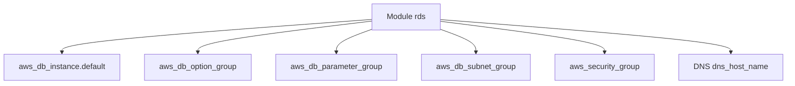

# cloudposse/terraform-aws-rds

> Module Terraform pour créer une instance AWS RDS avec groupes, DNS et sécurité, pour équipes d'infrastructure.

## Le problème
Une base RDS demande des groupes d'options, de paramètres, de sous-réseaux et de sécurité à déclarer un par un.

## Ce que ça fait vraiment
Le module crée l'instance (MySQL, Postgres, SQL Server, Oracle), les groupes d'option, de paramètres, de sous-réseaux et de sécurité, plus un enregistrement DNS Route53. Il gère aussi sauvegardes, chiffrement, multi-AZ, réplicas et restauration à un instant donné.

## Comment c'est branché
Schéma simplifié d'après la fiche, sans diagramme fourni.



## Essayer
```hcl
module "rds_instance" {
    source = "cloudposse/rds/aws"
    namespace = "eg"
    stage     = "prod"
    name      = "app"
    # voir l'exemple complet du README
}
```

## Coût et pièges
Compte AWS, Terraform 1.3 ou plus, fournisseur AWS 5.92 ou plus, et la facture RDS. Le README recommande d'épingler la version du module.

## Ce que ce n'est pas
Pas un module pour Aurora (c'est le rôle de terraform-aws-rds-cluster). Le mot de passe en clair dans l'exemple est à remplacer par une gestion de secrets.

## Alternatives
terraform-aws-rds-cluster : pour un cluster Aurora MySQL ou Postgres, comme le cite le README.

## Pour toi
À surveiller : pratique si tu provisionnes des bases RDS par Terraform pour tes données, sinon hors sujet.

