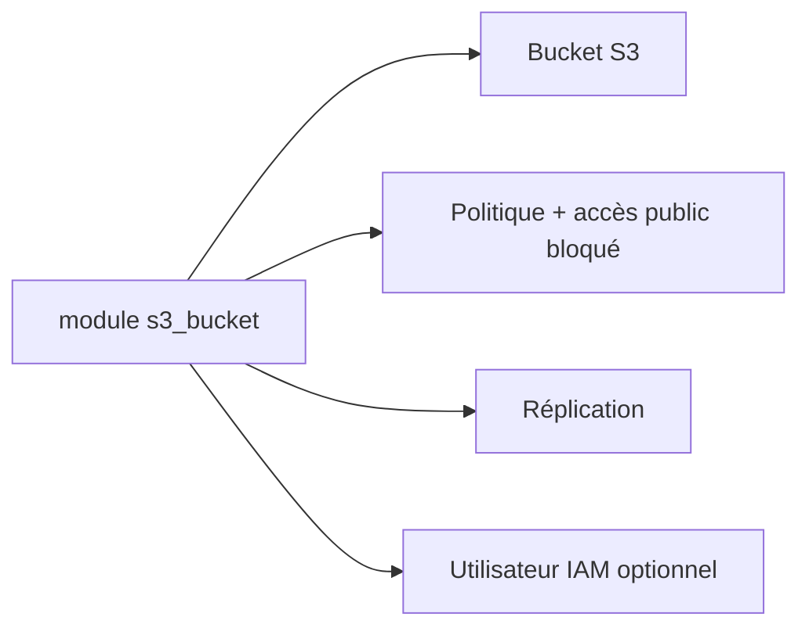

# cloudposse/terraform-aws-s3-bucket

> Terraform module that creates an S3 bucket with versioning, lifecycle, encryption, replication and secure access.

## The problem
A proper S3 bucket requires about ten linked resources (ACL, ownership, public access, policies, encryption).

## What it actually does
Creates the bucket with public access blocked by default, with versioning, lifecycle, object lock, replication, CORS, notifications, website hosting, intelligent tiering. Recommended access is through IAM roles (`privileged_principal_arns`); an IAM user is possible but stores the key in plain text in the state.

## How it is wired


## Trying it
```bash
module "s3_bucket" { source = "cloudposse/s3-bucket/aws" }
```
With `s3_object_ownership = "BucketOwnerEnforced"`.

## Cost and gotchas
AWS storage and requests are billed to you. The `ObjectWriter` default is kept for compatibility; `BucketOwnerEnforced` is preferable.

## What it is not
Not a data management module: it sets up the bucket's infrastructure.

## Alternatives
terraform-aws-s3-log-storage, for logs (cited in the README).

## For you
Adopt: for storing datasets, model artifacts and MLOps state with good defaults on AWS.
