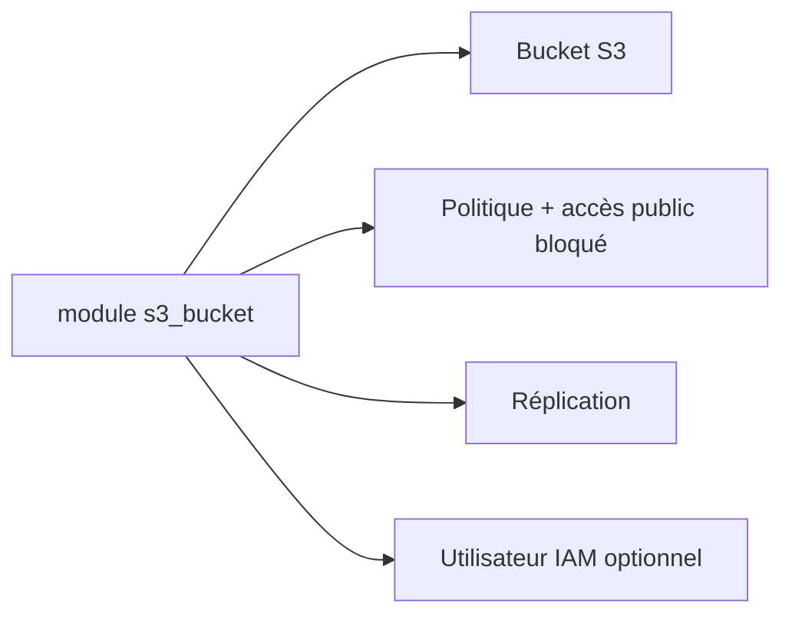

# cloudposse/terraform-aws-s3-bucket

> Module Terraform qui crée un bucket S3 avec versioning, cycle de vie, chiffrement, réplication et accès sécurisé.

## Le problème
Un bucket S3 correct demande une dizaine de ressources liées (ACL, ownership, accès public, politiques, chiffrement).

## Ce que ça fait vraiment
Crée le bucket en bloquant l'accès public par défaut, avec versioning, cycle de vie, verrou d'objet, réplication, CORS, notifications, hébergement web, tiering intelligent. Accès recommandé par rôles IAM (`privileged_principal_arns`) ; un utilisateur IAM est possible mais stocke la clé en clair dans le state.

## Comment c'est branché


## Essayer
```bash
module "s3_bucket" { source = "cloudposse/s3-bucket/aws" }
```
Avec `s3_object_ownership = "BucketOwnerEnforced"`.

## Coût et pièges
Stockage et requêtes AWS à ta charge. Le défaut `ObjectWriter` est conservé par compatibilité, mieux vaut `BucketOwnerEnforced`.

## Ce que ce n'est pas
Pas un module de gestion de données : il pose l'infra du bucket.

## Alternatives
terraform-aws-s3-log-storage, pour les logs (cité dans le README).

## Pour toi
À adopter : pour stocker datasets, artefacts de modèles et state MLOps avec de bons défauts sur AWS.

