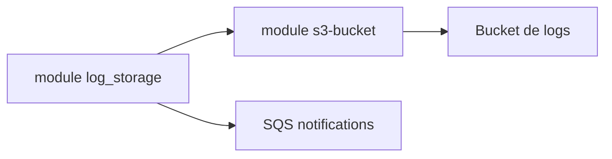

# cloudposse/terraform-aws-s3-log-storage

> Terraform module that creates an S3 bucket ready to receive S3, CloudFront and CloudTrail logs.

## The problem
A log bucket needs proper delivery permissions, retention and encryption.

## What it actually does
Wraps the s3-bucket module with preconfigured options: default encryption, public access blocked, versioning, lifecycle rules (Glacier then expiration) and optional SQS notifications. Default ACL `log-delivery-write`.

## How it is wired


## Trying it
```bash
module "log_storage" { source = "cloudposse/s3-log-storage/aws" }
```
With `lifecycle_configuration_rules`.

## Cost and gotchas
AWS storage at your expense. Without `lifecycle_rule_enabled = false`, deprecated default rules are added to yours.

## What it is not
Neither a log analysis tool nor an aggregator.

## Alternatives
terraform-aws-s3-bucket for direct control (cited in the README).

## For you
Watch: handy for tracing access to your data buckets, otherwise use the s3-bucket module.
