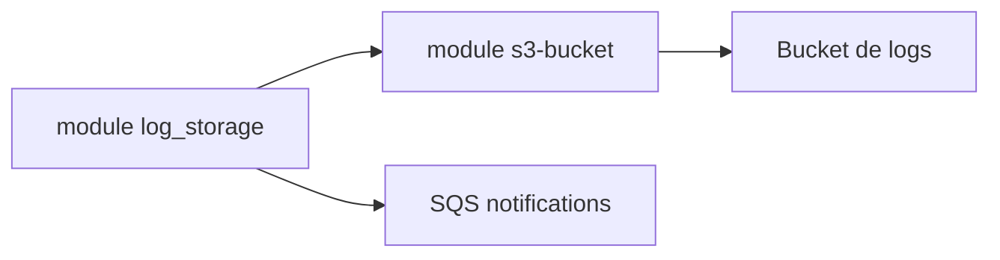

# cloudposse/terraform-aws-s3-log-storage

> Module Terraform qui crée un bucket S3 prêt à recevoir les logs de S3, CloudFront et CloudTrail.

## Le problème
Un bucket de logs a besoin de bons droits de livraison, de rétention et de chiffrement.

## Ce que ça fait vraiment
Enveloppe le module s3-bucket avec des options préconfigurées : chiffrement par défaut, accès public bloqué, versioning, règles de cycle de vie (Glacier puis expiration) et notifications SQS optionnelles. ACL par défaut `log-delivery-write`.

## Comment c'est branché


## Essayer
```bash
module "log_storage" { source = "cloudposse/s3-log-storage/aws" }
```
Avec `lifecycle_configuration_rules`.

## Coût et pièges
Stockage AWS à ta charge. Sans `lifecycle_rule_enabled = false`, des règles dépréciées par défaut s'ajoutent aux tiennes.

## Ce que ce n'est pas
Ni un outil d'analyse de logs ni un agrégateur.

## Alternatives
terraform-aws-s3-bucket pour un contrôle direct (cité dans le README).

## Pour toi
À surveiller : pratique pour tracer l'accès à tes buckets de données, sinon utilise le module s3-bucket.

