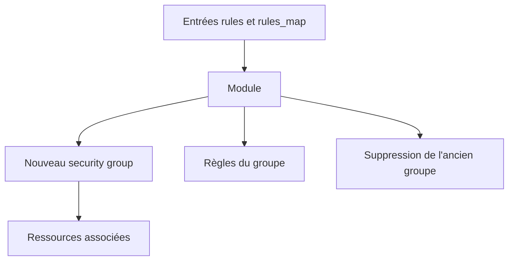

# cloudposse/terraform-aws-security-group

> Terraform module that creates an AWS security group and its rules while limiting service outages.

## The problem
Modifying a security group with Terraform can delete rules before recreating them and cut traffic.

## What it actually does
Creates or modifies a security group and its rules. By default (`create_before_destroy = true`, `preserve_security_group_id = false`), any rule change creates a new group before deleting the old one. Three rule inputs: `rules`, `rules_map`, `rule_matrix`. Keys stabilize the rules.

## How it is wired
Simplified diagram based on the sheet, no diagram provided.


## Trying it
```bash
# Aucune commande dans la partie lue du README : la section Usage est descriptive.
```

## Cost and gotchas
Free, AWS account required. `preserve_security_group_id = true` causes brief outages on update. `inline_rules_enabled` is not supported. README truncated in the material provided.

## What it is not
Not an application firewall nor a security audit: a module that manages AWS rules without scanning their content.

## Alternatives
No alternative named in the README.

## For you
Worth watching if you deploy AWS security groups with Terraform; otherwise unrelated to data.
