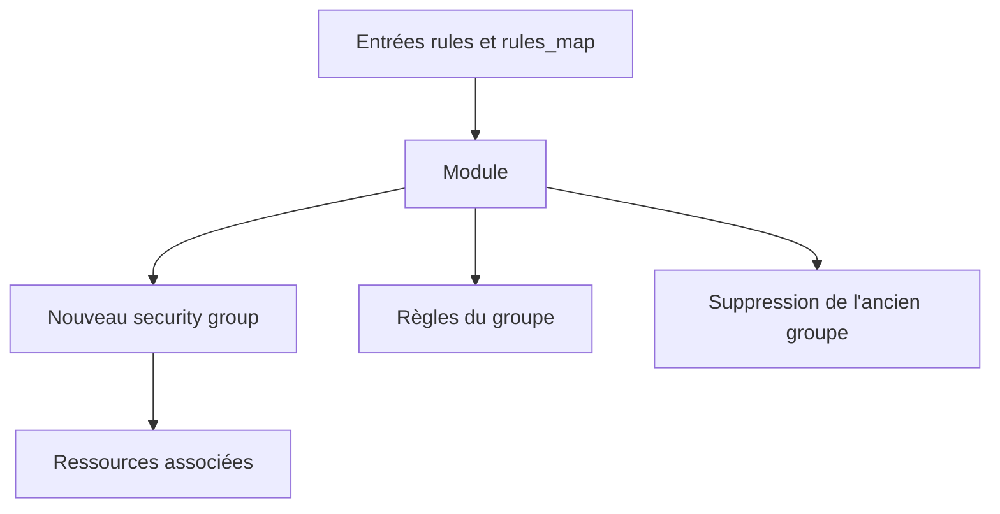

# cloudposse/terraform-aws-security-group

> Module Terraform qui crée un groupe de sécurité AWS et ses règles en limitant les coupures de service.

## Le problème
Modifier un groupe de sécurité avec Terraform peut supprimer des règles avant de les recréer et couper le trafic.

## Ce que ça fait vraiment
Crée ou modifie un groupe de sécurité et ses règles. Par défaut (`create_before_destroy = true`, `preserve_security_group_id = false`), tout changement de règle crée un nouveau groupe avant de supprimer l'ancien. Trois entrées de règles : `rules`, `rules_map`, `rule_matrix`. Des clés stabilisent les règles.

## Comment c'est branché
Schéma simplifié d'après la fiche, sans diagramme fourni.


## Essayer
```bash
# Aucune commande dans la partie lue du README : la section Usage est descriptive.
```

## Coût et pièges
Gratuit, compte AWS requis. `preserve_security_group_id = true` provoque des coupures brèves à la mise à jour. `inline_rules_enabled` n'est pas supporté. README tronqué dans la matière fournie.

## Ce que ce n'est pas
Pas un pare-feu applicatif ni un audit de sécurité : un module qui gère des règles AWS sans scanner leur contenu.

## Alternatives
Aucune alternative nommée dans le README.

## Pour toi
À surveiller si tu poses des groupes de sécurité AWS en Terraform ; sinon sans lien avec la data.

