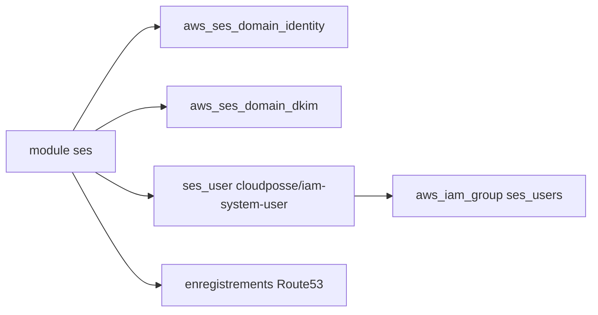

# cloudposse/terraform-aws-ses

> Terraform module that creates an AWS SES domain identity and an IAM sending user, for infra teams.

## The problem
Setting up email sending through SES by hand (domain, DKIM, SPF, IAM user) is slow and easy to get wrong.

## What it actually does
Creates the SES domain identity, an IAM group and an IAM user allowed to send (`ses:SendRawEmail` by default). With a Route53 `zone_id`, it adds the verification, DKIM, SPF and MX records for the custom sending domain. It produces an access key and an SMTP password.

## How it is wired
Simplified diagram based on the sheet, no diagram provided.



## Trying it
```bash
atmos test run
atmos test clean
atmos test --help
```
The README points to `examples/complete` for usage; these commands run the tests.

## Cost and gotchas
AWS account required. Every SES account starts in the sandbox: sending to unverified addresses requires a request to AWS support. The access key and SMTP password are written in clear text in the Terraform state.

## What it is not
It is not a turnkey sending service: it does not lift the SES sandbox. Nor is it an email campaign management tool.

## Alternatives
No alternative named in the README.

## For you
Worth watching: useful only if your AWS infrastructure is already in Terraform, and the clear-text secret in the state calls for vigilance.
