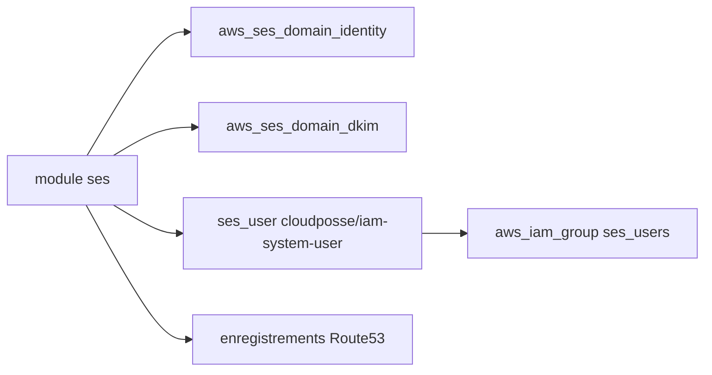

# cloudposse/terraform-aws-ses

> Module Terraform qui crée une identité de domaine AWS SES et un utilisateur IAM d'envoi, pour les équipes infra.

## Le problème
Configurer l'envoi d'e-mails par SES à la main (domaine, DKIM, SPF, utilisateur IAM) est long et source d'oublis.

## Ce que ça fait vraiment
Crée l'identité de domaine SES, un groupe et un utilisateur IAM autorisé à envoyer (`ses:SendRawEmail` par défaut). Avec un `zone_id` Route53, il ajoute les enregistrements de vérification, DKIM, SPF et MX du domaine d'expédition personnalisé. Il produit une clé d'accès et un mot de passe SMTP.

## Comment c'est branché
Schéma simplifié d'après la fiche, sans diagramme fourni.



## Essayer
```bash
atmos test run
atmos test clean
atmos test --help
```
Le README renvoie à `examples/complete` pour l'usage ; ces commandes lancent les tests.

## Coût et pièges
Compte AWS requis. Tout compte SES démarre en sandbox : l'envoi vers des adresses non vérifiées demande une demande au support AWS. La clé d'accès et le mot de passe SMTP sont écrits en clair dans le state Terraform.

## Ce que ce n'est pas
Ce n'est pas un service d'envoi clé en main : il ne lève pas la sandbox SES. Ce n'est pas non plus un outil de gestion de campagnes d'e-mails.

## Alternatives
Aucune alternative nommée dans le README.

## Pour toi
À surveiller : utile seulement si ton infra AWS est déjà en Terraform, et le secret en clair dans le state demande une vigilance.

