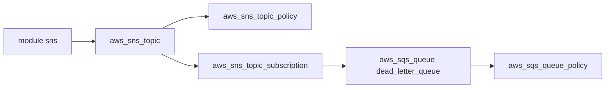

# cloudposse/terraform-aws-sns-topic

> Terraform module that creates an AWS SNS topic, its policy, its subscriptions and an SQS error queue.

## The problem
An SNS topic with encryption, access policy and subscribers requires several linked resources, long to write correctly.

## What it actually does
Creates the SNS topic (standard or FIFO), its policy and its subscriptions (sqs, lambda, https, etc.). It encrypts by default with the KMS key `alias/aws/sns`. A dead-letter SQS queue is possible. Cited example: CloudWatch alerts to PagerDuty or OpsGenie.

## How it is wired
Simplified diagram based on the sheet, no diagram provided.



## Trying it
```bash
atmos test run
atmos test clean
```
The usage itself is an HCL block (`module "sns"` with `source = "cloudposse/sns-topic/aws"`) given in the README.

## Cost and gotchas
AWS account required; SNS and SQS bill per usage. The catalog shows no license, and the last push dates from August 2025.

## What it is not
It is not a ready-to-use messaging system: it only provisions the infrastructure. CloudWatch alarms belong to neighboring modules.

## Alternatives
Neighboring modules are listed under "Related Projects" (for example terraform-aws-sqs-cloudwatch-sns-alarms), but they are complements, not replacements.

## For you
Worth watching: handy for the alerting of an MLOps platform on AWS, but no license and a low-activity repository.
