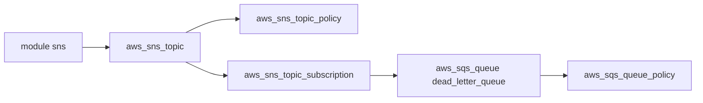

# cloudposse/terraform-aws-sns-topic

> Module Terraform qui crée un topic AWS SNS, sa politique, ses abonnements et une file d'erreurs SQS.

## Le problème
Un topic SNS avec chiffrement, politique d'accès et abonnés demande plusieurs ressources liées, longues à écrire correctement.

## Ce que ça fait vraiment
Crée le topic SNS (standard ou FIFO), sa politique et ses abonnements (sqs, lambda, https, etc.). Il chiffre par défaut avec la clé KMS `alias/aws/sns`. Une file SQS de lettres mortes est possible. Exemple cité : alertes CloudWatch vers PagerDuty ou OpsGenie.

## Comment c'est branché
Schéma simplifié d'après la fiche, sans diagramme fourni.



## Essayer
```bash
atmos test run
atmos test clean
```
L'usage lui-même est un bloc HCL (`module "sns"` avec `source = "cloudposse/sns-topic/aws"`) donné dans le README.

## Coût et pièges
Compte AWS requis ; SNS et SQS facturent à l'usage. Le catalogue n'affiche aucune licence, et le dernier push date d'août 2025.

## Ce que ce n'est pas
Ce n'est pas une messagerie prête à l'emploi : il ne provisionne que l'infrastructure. Les alarmes CloudWatch relèvent de modules voisins.

## Alternatives
Des modules voisins sont listés sous « Related Projects » (par exemple terraform-aws-sqs-cloudwatch-sns-alarms), mais ce sont des compléments, pas des remplaçants.

## Pour toi
À surveiller : pratique pour l'alerting d'une plateforme MLOps sur AWS, mais licence absente et dépôt peu actif.

