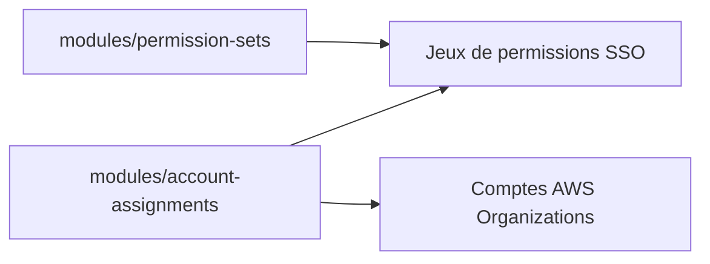

# cloudposse/terraform-aws-sso

> Terraform modules for AWS SSO: permission sets and assignment of users and groups to accounts.

## The problem
Manually managing centralized access to several AWS accounts and the associated permissions.

## What it actually does
Two submodules: `modules/permission-sets` creates AWS SSO permission sets, `modules/account-assignments` assigns users and groups to those sets in specific accounts. The README details neither inputs nor outputs; a complete example is in `examples/complete`.

## How it is wired
Simplified diagram based on the sheet, no diagram provided.

## Trying it
No command documented in the README; see `examples/complete`.

## Cost and gotchas
An AWS Organizations account with SSO enabled. Last push in August 2026. The examples do not pin a version: pin the module's version yourself.

## What it is not
Not an identity provider: it configures permissions, not the users of a directory. The input and output tables are empty in the README.

## Alternatives
None named in the README.

## For you
Ignore: enterprise AWS access management, useful only if you administer the AWS organization that hosts your projects.
