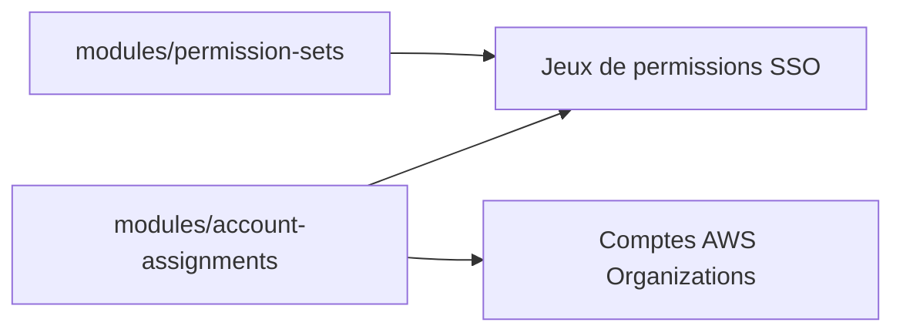

# cloudposse/terraform-aws-sso

> Modules Terraform pour AWS SSO : jeux de permissions et affectation d'utilisateurs et de groupes aux comptes.

## Le problème
Gérer à la main l'accès centralisé à plusieurs comptes AWS et les permissions associées.

## Ce que ça fait vraiment
Deux sous-modules : `modules/permission-sets` crée des jeux de permissions AWS SSO, `modules/account-assignments` affecte utilisateurs et groupes à ces jeux dans des comptes précis. Le README ne détaille ni entrées ni sorties ; un exemple complet est dans `examples/complete`.

## Comment c'est branché
Schéma simplifié d'après la fiche, sans diagramme fourni.

## Essayer
Aucune commande documentée dans le README ; voir `examples/complete`.

## Coût et pièges
Compte AWS Organizations avec SSO activé. Dernier push en août 2026. Les exemples ne fixent pas de version : épingler soi-même celle du module.

## Ce que ce n'est pas
Pas un fournisseur d'identité : il configure les permissions, pas les utilisateurs d'un annuaire. Les tables d'entrées et sorties sont vides dans le README.

## Alternatives
Aucune nommée dans le README.

## Pour toi
Ignorer : gestion d'accès AWS d'entreprise, utile seulement si tu administres l'organisation AWS qui héberge tes projets.

