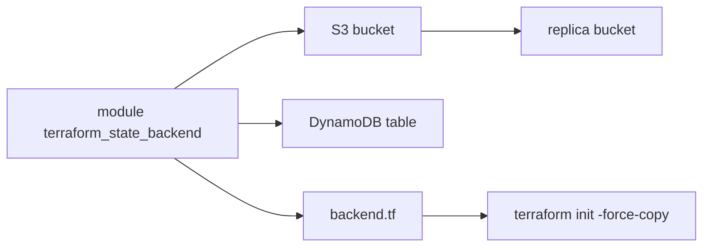

# cloudposse/terraform-aws-tfstate-backend

> Terraform module that creates the S3 bucket and DynamoDB table to store Terraform state, for AWS teams.

## The problem
A Terraform state kept locally gets lost, corrupted or overwritten when several people apply at the same time. A locked remote storage is needed.

## What it actually does
Provisions an encrypted, versioned S3 bucket, plus a DynamoDB locking table. It writes a `backend.tf` file pointing to this storage. It also offers bucket replication and native S3 locking (Terraform 1.10 and later). It does not create a lifecycle rule: you add it yourself.

## How it is wired
Simplified diagram based on the sheet, no diagram provided.



## Trying it
```bash
terraform init
terraform apply -auto-approve
terraform init -force-copy
```

## Cost and gotchas
AWS account required, with the right to create S3 buckets and DynamoDB tables. Bootstrapping happens in two steps (local state, then migration). DynamoDB locking is deprecated from Terraform 1.10.

## What it is not
Not a standalone tool: you must already write Terraform. It does not manage `mfa_delete`, which is changed by hand with the root account. It does not create a lifecycle rule.

## Alternatives
- terraform-aws-dynamodb: separate module for the DynamoDB table alone.

## For you
Worth watching: useful only if you deploy MLOps infrastructure on AWS with Terraform, since it cleanly solves state storage.
