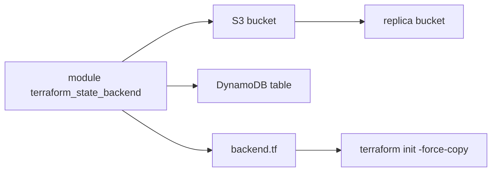

# cloudposse/terraform-aws-tfstate-backend

> Module Terraform qui crée le bucket S3 et la table DynamoDB pour stocker l'état Terraform, pour les équipes AWS.

## Le problème
Un état Terraform gardé en local se perd, se corrompt ou s'écrase quand plusieurs personnes appliquent en même temps. Il faut un stockage distant verrouillé.

## Ce que ça fait vraiment
Provisionne un bucket S3 chiffré et versionné, plus une table DynamoDB de verrouillage. Il écrit un fichier `backend.tf` qui pointe vers ce stockage. Il propose aussi la réplication du bucket et le verrouillage natif S3 (Terraform 1.10 et plus). Il ne crée pas de règle de cycle de vie : on l'ajoute soi-même.

## Comment c'est branché
Schéma simplifié d'après la fiche, sans diagramme fourni.



## Essayer
```bash
terraform init
terraform apply -auto-approve
terraform init -force-copy
```

## Coût et pièges
Compte AWS requis, avec le droit de créer des buckets S3 et des tables DynamoDB. L'amorçage se fait en deux temps (état local, puis migration). Le verrouillage DynamoDB est déprécié à partir de Terraform 1.10.

## Ce que ce n'est pas
Ce n'est pas un outil autonome : il faut déjà écrire du Terraform. Il ne gère pas `mfa_delete`, qui se change à la main avec le compte root. Il ne crée pas de règle de cycle de vie.

## Alternatives
- terraform-aws-dynamodb : module séparé pour la seule table DynamoDB.

## Pour toi
Surveiller : utile seulement si tu déploies de l'infra MLOps sur AWS avec Terraform, car il règle proprement le stockage d'état.

