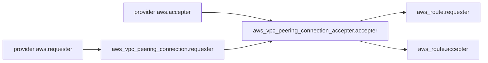

# cloudposse/terraform-aws-vpc-peering-multi-account

> Terraform module that creates a peering between two AWS VPCs in different accounts, for infra teams.

## The problem
Connecting two VPCs belonging to separate AWS accounts requires manually coordinating the requester, the accepter, the routes and the IAM roles.

## What it actually does
Creates the peering connection, accepts it automatically by default, adds routes on both sides (IPv4 and IPv6) and sets up remote DNS resolution. Can run from a third account by assuming a role in each member account. The README provides the necessary IAM policies.

## How it is wired


## Trying it
```bash
atmos test run
atmos test clean
atmos test --help
```

## Cost and gotchas
You need two AWS accounts, IAM roles with the README's policies and Terraform 1.3 or later. Do not point to `master`: pin a published version. A peering can only be deleted from the requester side in Terraform.

## What it is not
Not a module for two VPCs in the same account: another module exists for that. It does not create the VPCs.

## Alternatives
- terraform-aws-vpc-peering: preferable when both VPCs are in the same AWS account.
- terraform-aws-kops-vpc-peering: preferable for connecting a VPC created by Kops.

## For you
Ignore for a data / AI / MLOps profile, unless you manage multi-account AWS networking yourself: a targeted network infrastructure module with no link to data.
