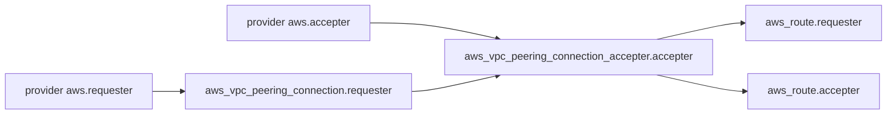

# cloudposse/terraform-aws-vpc-peering-multi-account

> Module Terraform qui crée un peering entre deux VPC AWS de comptes différents, pour les équipes infra.

## Le problème
Relier deux VPC appartenant à des comptes AWS distincts demande de coordonner à la main le requester, l'accepter, les routes et les rôles IAM.

## Ce que ça fait vraiment
Crée la connexion de peering, l'accepte automatiquement par défaut, ajoute les routes des deux côtés (IPv4 et IPv6) et règle la résolution DNS distante. Peut s'exécuter depuis un troisième compte en assumant un rôle dans chaque compte membre. Le README fournit les politiques IAM nécessaires.

## Comment c'est branché


## Essayer
```bash
atmos test run
atmos test clean
atmos test --help
```

## Coût et pièges
Il faut deux comptes AWS, des rôles IAM avec les politiques du README et Terraform 1.3 ou plus. Ne pas pointer vers `master` : épingler une version publiée. Un peering ne se supprime que depuis le côté requester dans Terraform.

## Ce que ce n'est pas
Pas un module pour deux VPC du même compte : un autre module existe pour cela. Il ne crée pas les VPC.

## Alternatives
- terraform-aws-vpc-peering : à préférer quand les deux VPC sont dans le même compte AWS.
- terraform-aws-kops-vpc-peering : à préférer pour relier un VPC créé par Kops.

## Pour toi
À ignorer pour un profil data / IA / MLOps, sauf si tu gères toi-même le réseau multi-comptes AWS : c'est un module d'infrastructure réseau ciblé, sans lien avec les données.

